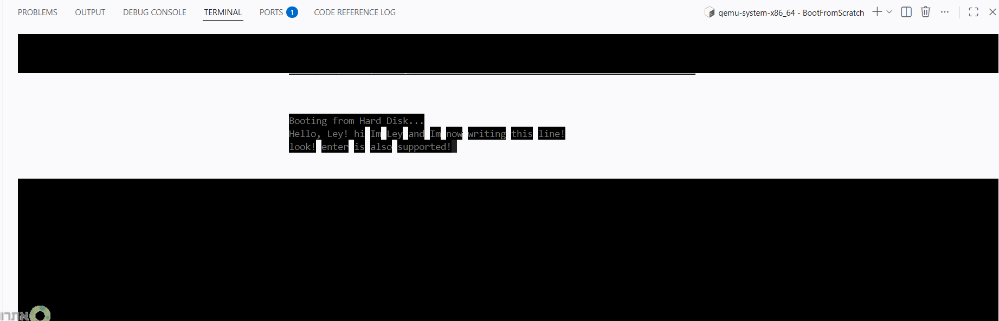

# BootFromScratch

A bare-metal x86 boot sector, built step by step to understand what happens before the OS loads.

I started this project because I wanted to learn more assembly.
I always felt connected to low-level programming, and it felt like a challenge I had to try.
Today, the program prints `Hello, Ley!`, and then shows every key you type.
Enter starts a new line, and Esc stops the echo.



## Stages

| Stage | What it does | Code | Journal |
|---|---|---|---|
| 1 | Minimal 512-byte boot sector with `0xAA55` signature and an infinite loop | [v0.1](https://github.com/LeyBrand/BootFromScratch/tree/v0.1) | [notes](docs/journal.md#stage-1--empty-boot) |
| 2 | Prints a single character via BIOS `int 0x10` | [v0.2](https://github.com/LeyBrand/BootFromScratch/tree/v0.2) | [notes](docs/journal.md#stage-2--print-a-char) |
| 3 | Prints a null-terminated string in a loop (`DS:SI` addressing) | [v0.3](https://github.com/LeyBrand/BootFromScratch/tree/v0.3) | [notes](docs/journal.md#stage-3--print-a-string) |
| 4 | Echoes keyboard input via `int 0x16` until Esc, handles Enter (CR/LF) | [v0.4](https://github.com/LeyBrand/BootFromScratch/tree/v0.4) | [notes](docs/journal.md#stage-4--keyboard-echo) |

## How I work

Each stage is one small step:

1. A branch for the stage (`stage/<n>-<name>`)
2. A pull request that explains what I learned and what surprised me
3. A journal entry in [docs/journal.md](docs/journal.md)
4. A tag (`v0.n`), so every stage can be opened exactly as it was

Branch, commit and PR rules are in [CONTRIBUTING.md](CONTRIBUTING.md).

## Key concepts

- **The boot signature:** the BIOS runs the first 512 bytes only if the last 2 bytes are `55 AA`. I changed one byte, and the BIOS refused to boot.
- **Data vs. code:** the CPU doesn't know what is code and what is data. If a string is in the code path, the CPU runs the letters as instructions.
- **Segment:offset addressing:** in 16-bit mode, real address = `DS` × 16 + `SI`, so I set `DS` to 0 myself.
- **BIOS calls change registers:** `int 0x16` overwrote `AH`, so I had to set it again before printing.

## Build & run

Prerequisites:

```
sudo apt install nasm qemu-system-x86
```

Build:

```
nasm -f bin src/boot.asm -o boot.img
```

Run:

```
qemu-system-x86_64 -drive format=raw,file=boot.img -display curses
```

To exit, open a second terminal and run `pkill qemu`.

## Next ideas

- [ ] Stage 5 – Load additional sectors from disk (`int 0x13`)
- [ ] Stage 6 – Switch to 32-bit protected mode (GDT)
- [ ] Stage 7 – Jump into a kernel written in C
- [ ] Stage 8 – Print from C by writing directly to VGA memory (`0xB8000`)